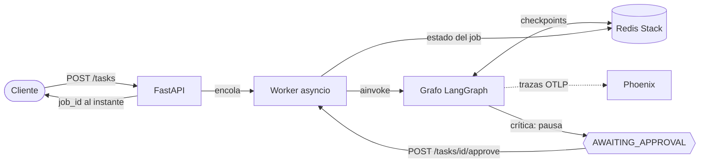
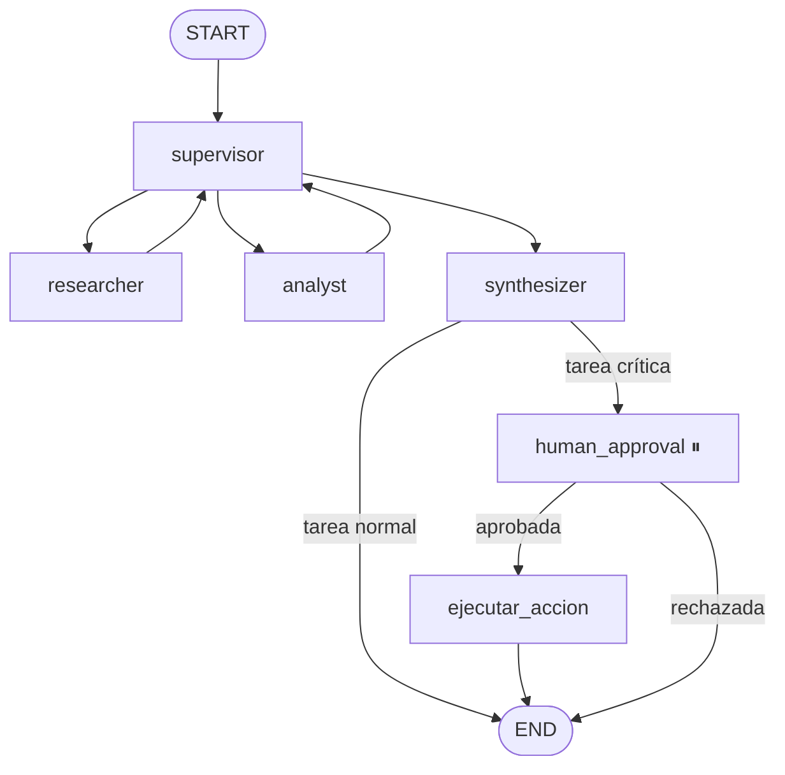

# Huerta Viva · API de agentes en producción

API REST asíncrona (FastAPI) que expone el sistema multi-agente del Módulo 6 (supervisor +
investigador + analista + sintetizador sobre las normas y reseñas de una cooperativa de huertas)
con cuatro capacidades de producción:

| Capacidad | Cómo se resuelve |
|---|---|
| **Endpoints asíncronos** | `POST /tasks` encola y devuelve un `job_id` al instante; un worker corre el grafo en segundo plano (`app/worker.py`). |
| **Estado en Redis** | Estado de cada job (`job:{id}`) y checkpoints de LangGraph (`AsyncRedisSaver`), incluido el paso a `FAILED` ante cualquier excepción. |
| **Observabilidad** | Trazas de cada nodo, herramienta y llamada al LLM en **Arize Phoenix** (OpenInference), con costo y latencia. |
| **Human-in-the-loop** | Las tareas críticas se **pausan** (`interrupt`) hasta que una persona aprueba con `POST /tasks/{id}/approve`. |



Grafo (el del M6 más la aprobación humana al final):



## Estructura

```
├── app/
│   ├── main.py            # FastAPI: POST /tasks · GET /tasks/{id} · GET /health
│   ├── graph.py           # orquestador del M6 + aprobación humana + checkpointer (AsyncRedisSaver)
│   ├── worker.py          # corre el grafo en segundo plano; PENDING/RUNNING/AWAITING_APPROVAL/DONE/FAILED/REJECTED
│   ├── jobs.py            # estado de los jobs en Redis (async, con transición atómica)
│   ├── observability.py   # init de Phoenix + span raíz por job (session.id = job_id)
│   ├── hitl.py            # nodo de aprobación (interrupt) + acción crítica + POST /tasks/{id}/approve
│   ├── supervisor.py, agents/, tools/, state.py, prompts.py, retrieval.py, vector_db.py   # M6
│   ├── llm.py, config.py  # un único punto para el modelo y la configuración
├── scripts/load_test.py   # 5 peticiones concurrentes
├── tests/                 # 28 tests (sin LLM ni API key)
├── data/, vectorstore/    # reseñas y base vectorial de Chroma (del M6)
├── screenshots/           # capturas del dashboard de Phoenix
├── docker-compose.yml, Dockerfile, requirements.txt, .env.example
```

## Requisitos

- Python 3.12+ y Docker (para Redis Stack y Phoenix).
- **Ollama con el modelo de embeddings** (la base vectorial se indexó con `bge-m3`):
  ```bash
  ollama pull bge-m3
  ```
- **Una API key gratuita de Gemini** (Google AI Studio). Va solo en tu `.env`.

> **Por qué Redis *Stack* y no `redis`:** el checkpointer de LangGraph usa los módulos RedisJSON y
> RediSearch, que solo trae `redis/redis-stack-server`. Con la imagen `redis` a secas falla.

## Cómo levantar todo

```bash
git clone <este-repo> && cd <este-repo>
cp .env.example .env
```

Edita `.env` y añade tu clave en formato `CLAVE=VALOR` (sin `:` ni comillas):

```dotenv
GOOGLE_API_KEY=<tu-clave-de-Google-AI-Studio>
GEMINI_MODEL=gemini-2.5-flash-lite
```

Confirma el identificador disponible en Google AI Studio. El archivo `.env` está excluido por
`.gitignore` y no debe subirse al repositorio.

### Opción A · Docker Compose (Redis + Phoenix + API)

```bash
docker compose up --build
```

- API y documentación interactiva: <http://localhost:8000/docs>
- Phoenix: <http://localhost:6006> (sin login: el compose desactiva la autenticación, solo para uso local)

### Opción B · Redis y Phoenix en Docker, API local

```bash
docker compose up -d redis phoenix

python3 -m venv .venv
source .venv/bin/activate       # Linux/macOS
# En Windows (PowerShell): .venv\Scripts\Activate.ps1

python -m pip install --upgrade pip
python -m pip install -r requirements.txt
python -m uvicorn app.main:app --port 8000
```

Para salir del entorno virtual usa `deactivate`. Si el entorno ya existe, basta con activar `.venv`
y ejecutar la instalación; no hace falta recrearlo.

Comprobación: `curl localhost:8000/health` → `{"status":"ok","redis":true,...}`.

## Probarlo a mano

**Tarea normal** (solo lectura, no se pausa):

```bash
curl -s -X POST localhost:8000/tasks -H 'content-type: application/json' \
  -d '{"question":"¿Qué opinan los socios sobre las cuotas? Dime el porcentaje de opiniones positivas."}'
# -> {"job_id":"3f9c...","status":"PENDING","requires_approval":false,"status_url":"/tasks/3f9c..."}

curl -s localhost:8000/tasks/<job_id>        # PENDING -> RUNNING -> DONE (con "result")
```

**Tarea crítica con aprobación humana** (pide *enviar* algo hacia afuera):

```bash
curl -s -X POST localhost:8000/tasks -H 'content-type: application/json' \
  -d '{"question":"Calcula el porcentaje de opiniones positivas sobre las cuotas y envía el informe al consejo."}'
# requires_approval: true

curl -s localhost:8000/tasks/<job_id>
# -> "status":"AWAITING_APPROVAL" y "pending_approval": {el borrador que se enviaría}
#    (la acción todavía NO se ejecutó)

curl -s -X POST localhost:8000/tasks/<job_id>/approve -H 'content-type: application/json' \
  -d '{"approved": true, "comment": "ok, enviar"}'
# -> DONE con "action_result" (envío registrado en la bandeja de salida `outbox:consejo` de Redis)
#    con {"approved": false} termina en REJECTED y no se envía nada.
```

Los estados son: `PENDING → RUNNING → (AWAITING_APPROVAL → RUNNING →) DONE | REJECTED`, y `FAILED`
(con `"error"`) si algo falla en cualquier punto. Un job siempre termina en un estado final.

> **Si Phoenix te pide login.** Desde `arize-phoenix` 21 la imagen de Docker activa la autenticación por
> defecto y rechaza las trazas que no traen API key (las trazas no aparecen). El `docker-compose.yml` de este
> repo lo desactiva con `PHOENIX_ENABLE_AUTH=false`. Si usas otra forma de arrancar Phoenix, o prefieres
> dejarla activa: entra con `admin@localhost` / `admin` (te obliga a cambiar la contraseña), crea una
> *System API key* en la UI y ponla como `PHOENIX_API_KEY` en tu `.env`.

## Prueba de carga y evidencia (5 peticiones concurrentes)

Con la API y Phoenix levantados:

```bash
python scripts/load_test.py            # 5 tareas de solo lectura, a la vez
```

El script lanza las 5 tareas simultáneamente, espera a que terminen y muestra la latencia de cada
una (y su p50/p95 del lado del cliente, como contraste). Luego, **en Phoenix** (<http://localhost:6006>):

1. **Trazas** → abre el proyecto `huerta-viva-agentes` y una traza: se ve el árbol
   `job.run → LangGraph → supervisor / researcher / analyst / synthesizer → llamadas al LLM`.
   → captura `screenshots/01_trazas_arbol.png`.
2. **Costo por ejecución** → Phoenix lo calcula solo con los tokens de entrada/salida y su tabla
   de precios (incluye modelos Gemini). Se ve por traza (tabla de trazas / detalle) y agregado en el
   dashboard del proyecto (*Dashboards* en la barra lateral → elige el proyecto → *Cost*).
   → captura `screenshots/02_costo_por_ejecucion.png`.
3. **Latencia p95** → en el mismo *Dashboard* del proyecto, gráfico de *Trace latency percentiles*.
   → captura `screenshots/03_latencia_p95.png`.
   *Si en tu versión de Phoenix el gráfico no incluye p95 (solo otros percentiles), usa las
   latencias de las 5 trazas (columna de latencia) y el p95 que imprime el script, y muéstralos
   junto a la captura. Con 5 muestras el p95 es prácticamente la corrida más lenta.*
4. *(Opcional)* Lanza una tarea crítica, apruébala y captura la **Session** (`job_id`) con las dos
   trazas: `job.run` (hasta la pausa) y `job.resume` (tras aprobar) → `screenshots/04_hitl_traza.png`.

> **Límite gratuito de Gemini.** La capa gratuita tiene límites de peticiones por minuto (se ven por
> proyecto en Google AI Studio). Por eso la clasificación de sentimiento va en **una sola llamada** por
> corrida (en el M6 era una por reseña) y el cliente reintenta con backoff ante un 429
> (`LLM_MAX_RETRIES`). Si aun así ves 429 o latencias altas, baja `MAX_CONCURRENT_JOBS` o elige un
> modelo *Flash-Lite*.

### Lectura del dashboard *(completar con los números de TU corrida)*

| | Resultado |
|---|---|
| Costo por ejecución (promedio de las 5) | _… USD_ |
| Latencia p95 | _… s_ |
| Nodo que concentra la latencia | _… (¿el analista? ¿el investigador?)_ |
| Nodo que más tokens consume | _… (hipótesis: el analista o el sintetizador; confírmalo en las trazas)_ |
| Observaciones (reintentos por 429, picos, etc.) | _…_ |

## Decisiones de diseño

- **No bloquear el event loop.** Los nodos del M6 son síncronos; se invoca el grafo con `ainvoke` y
  LangGraph los ejecuta en un thread pool. Redis se usa con `redis.asyncio`. Hay un test que lanza 5
  jobs con un nodo bloqueante de 1 s y comprueba que `/health` responde en milisegundos y que corren
  en paralelo.
- **Worker simple.** Tareas `asyncio` dentro de FastAPI, con referencias guardadas (si no, el GC
  puede cancelarlas), un semáforo (`MAX_CONCURRENT_JOBS`) y `try/except` que deja el job en `FAILED`.
  Al arrancar, los jobs que quedaron `PENDING/RUNNING` de una ejecución anterior se pasan a `FAILED`
  (sin worker no terminarían nunca). Los `AWAITING_APPROVAL` se conservan: su checkpoint está en
  Redis y se pueden aprobar aunque el servicio se haya reiniciado.
- **Tarea crítica = acción con efecto secundario.** Las herramientas del M6 son de solo lectura, así
  que se añadió una acción final (enviar el informe al consejo, simulada en una bandeja de salida de
  Redis). Se considera crítica por una regla determinista (`hitl.es_critica`: verbos como
  enviar/mandar/notificar/publicar) o por el flag `requires_approval` del POST. Las tareas normales no
  se pausan.
- **El efecto va en otro nodo que la pausa.** Al reanudar, LangGraph re-ejecuta el nodo
  interrumpido desde el principio; por eso `human_approval` solo pregunta y `ejecutar_accion` (que
  corre una sola vez, tras aprobar) hace el envío. La aprobación usa una transición atómica en Redis:
  dos aprobaciones simultáneas no reanudan dos veces (una recibe `409`).
- **Sub-agentes sin checkpointer propio.** Investigador y analista se invocan *dentro* de un nodo; sin
  `checkpointer=False` heredarían el de Redis y guardarían decenas de checkpoints por job. La pausa del
  HITL ocurre en el grafo exterior, que es el único que se checkpointea.
- **Dos capas en Redis.** `job:{id}` (lo que ve el cliente, con TTL) y `checkpoint:*` (internos de
  LangGraph, con TTL). `job_id == thread_id`.
- **Modelo.** Gemini por `llm.py` (el único punto que cambia de proveedor). Los embeddings siguen en
  Ollama porque el vectorstore está indexado con `bge-m3` (cambiarlos obligaría a reingestar).
  `LLM_PROVIDER=ollama` vuelve al modelo local del M6.
- **Sentimiento en una llamada.** `analizar_lista_lote` clasifica todas las reseñas con una sola
  llamada estructurada; si el modelo omite alguna (o falla la llamada) se usa el plan B léxico del M6
  solo para esas, así el costo es siempre de una llamada.

## Tests

Con `.venv` activado:

```bash
python -m pip install -r requirements-dev.txt
python -m pytest -q
```

28 tests, sin LLM ni API key (los agentes se reemplazan por nodos falsos): regla de tareas críticas,
sentimiento por lote, el flujo HITL del grafo (pausa / aprobar / rechazar) y la API de punta a punta
(encolado, `FAILED`, aprobar / rechazar / `409`, huérfanos, no bloqueo del event loop) y una regresión que
garantiza que los sub-agentes ReAct del M6 no heredan el checkpointer de Redis. Los de la API
necesitan un Redis cualquiera en `REDIS_URL` (si no hay, se saltan); usan la base 15.

## Límites conocidos

- Una sola réplica del servicio: el worker vive en el proceso. Para escalar horizontalmente habría que
  pasar a Arq/Celery (los estados en Redis y la transición atómica ya están pensados para eso).
- La bandeja de salida (`outbox:consejo`) simula el envío; en producción iría un SMTP o webhook (y habría
  que hacerlo idempotente).
- Los modelos y límites de la capa gratuita de Gemini cambian con el tiempo: confirma el id del modelo en
  Google AI Studio y que Phoenix lo reconozca en *Settings → Models*.
